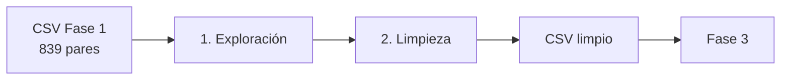
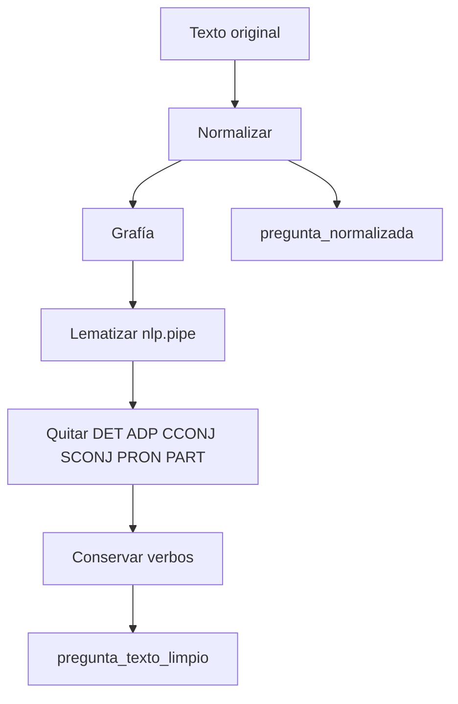

# Fase II — Entendimiento y preparación del corpus

**Módulo 4 · Unidad 3 · 10 % del proyecto aplicado**  
**Notebook:** [`M4U3_Fase_2_exploratory_data_analysis.ipynb`](M4U3_Fase_2_exploratory_data_analysis.ipynb)  
**Grupo 12:** David Martínez Triana · Andrés Ramírez Romero · David Delgado Ortiz

[← Volver al README del proyecto](../README.md)

---

## De qué trata esta fase

Explorar el corpus de la Fase I y **dejar el texto listo** para representarlo. Aquí vive el análisis descriptivo, las visualizaciones y el preprocesamiento NLP (normalización, grafía, lematización).

No se elige todavía el embedding final ni se entrena el recuperador. Sí se corre un **experimento de recuperación diagnóstico** (consulta corta vs pregunta / respuesta) para decidir qué columna conviene vectorizar en la Fase 3.



---

## Estructura del notebook

### 1. Análisis exploratorio

| Subsección | Pregunta que responde |
|------------|----------------------|
| 1.1 Resumen | ¿Cuántos documentos, en qué idioma, cuánto pesan? |
| 1.2 Calidad | ¿Vacíos, tipografía rara, mezcla de idiomas? |
| 1.3 Tipos | Longitudes, forma de la pregunta (cómo / qué / cuál…) |
| 1.4 Relaciones | Desbalance por fuente, duplicados, Jaccard pregunta–respuesta |

### 2. Limpieza

| Paso | Salida |
|------|--------|
| Normalización | minúsculas, espacios |
| Grafía | comillas, rayas, viñetas → ASCII |
| Lematización | spaCy + filtro POS (se conservan verbos) |
| Export | CSV limpio + Excel por pasos |

Documentación en orden **código → explicación** bajo cada ejecución.

---

## Qué se logró

### Hallazgos del corpus

| Hallazgo | Dato |
|----------|------|
| Tamaño | 839 pares, 22 fuentes |
| Desbalance | Top 5 = **68.9 %** del corpus |
| Longitud pregunta | media **11.7** palabras (máx. 41) |
| Longitud respuesta | media **72.9** (máx. 783, Estadística) |
| Preguntas distintas | **785** en 839 filas |
| Duplicadas entre fuentes | **24** preguntas (51 filas) |
| Jaccard pregunta–respuesta | mediana **0.064** (poco solape léxico) |
| Correlación longitudes Q–A | **≈ 0** (−0.02) |

Tipos de pregunta (primera interrogativa): *cómo* 221, *qué* 199, *cuál* 134. No se construyó un clasificador de intenciones: el conteo es descriptivo.

### Experimento diagnóstico (sección 2.1)

Con una consulta corta (sin palabras de función; si hay &gt; 3 tokens de contenido, se quita el último):

- Contra **pregunta normalizada** (unigramas): Recall@1 **≈ 0.912**
- Contra **respuesta**: Recall@1 **≈ 0.242**
- Lemas de la respuesta: solo sube a **≈ 0.268**

**Conclusión para la Fase 3:** representar primero `pregunta_normalizada` con palabras sueltas; los lemas quedan como segunda configuración; la respuesta no es el campo principal de búsqueda.

### Limpieza



- **0** preguntas vacías de lemas tras el filtro POS.
- Media **6.5** lemas útiles por pregunta.
- Análisis de ruido en lote (`nlp.pipe`); tras limpiar quedan **2** signos `°` (ordinales), conservados a propósito.

---

## Qué se aprendió

1. **El desbalance por fuente es un riesgo de recuperación:** páginas grandes pueden dominar vecinos si no se mira la procedencia.
2. **Duplicados cross-source son un feature, no un bug:** la misma pregunta en Ingeniería y Estadística exige mostrar más de un par.
3. **Jaccard bajo pregunta–respuesta** confirma que indexar la respuesta es mala idea para este corpus.
4. **Stopwords de spaCy ≠ filtro POS:** en español, borrar `hacer`/`poder` vacía FAQs reales.
5. **Eficiencia cuenta en la rúbrica:** `nlp.pipe` en lote, no `nlp()` fila a fila.
6. **Los ejes de las figuras no se recortan** si el hallazgo está en la cola (respuestas de 783 palabras).

---

## Archivos en esta carpeta

| Archivo | Rol |
|---------|-----|
| `M4U3_Fase_2_exploratory_data_analysis.ipynb` | Notebook de la entrega |
| `corpus_faq_unal.csv` | Entrada (copia de Fase I) |
| `corpus_faq_unal_fase2_limpio.csv` | Salida para Fases III y IV |
| `corpus_faq_unal_fase2_limpieza.xlsx` | Auditoría por pasos |

### Columnas del CSV limpio

`pregunta`, `respuesta`, `fuente`, `url`, `titulo_seccion`,  
`pregunta_normalizada`, `respuesta_normalizada`,  
`pregunta_texto_limpio`, `respuesta_texto_limpio`

---

## Cómo ejecutar

```bash
pip install pandas numpy matplotlib seaborn spacy openpyxl
python -m spacy download es_core_news_sm
# Ejecutar el notebook con cwd = esta carpeta
```

---

## Criterio de cierre (rúbrica)

- Exploración que **explica** el corpus.
- Análisis descriptivo **útil** para el trabajo posterior.
- Visualizaciones que ilustran el contenido.
- Preprocesamiento NLP **eficiente y preciso**.

Siguiente: [Fase III — Extracción de características](../Entrega%20proyecto%20Fase%20III/README.md).
