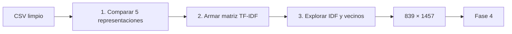
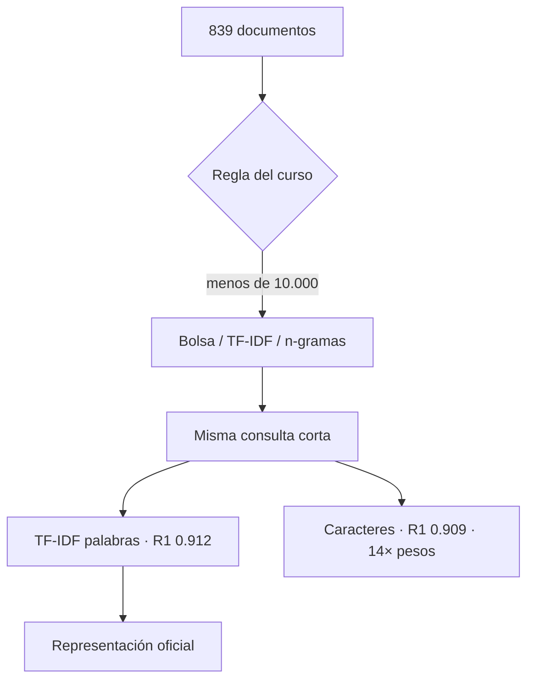
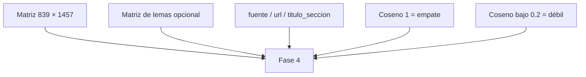

# Fase III — Extracción de características

**Módulo 4 · Unidad 4 · 10 % del proyecto aplicado**  
**Notebook:** [`M4U4_Fase_3_feature_extraction.ipynb`](M4U4_Fase_3_feature_extraction.ipynb)  
**Grupo 12:** David Martínez Triana · Andrés Ramírez Romero · David Delgado Ortiz

[← Volver al README del proyecto](../README.md)

---

## De qué trata esta fase

Elegir y construir la **representación vectorial** de las preguntas. El corpus es el limpio de la Fase 2 (839 pares). La tarea **no es clasificar**: es dejar un vector con el que la Fase 4 compare una consulta nueva contra las preguntas del índice.



---

## Estructura del notebook

| Sección | Contenido |
|---------|-----------|
| 1. Selección | Regla de tamaño del curso + tabla de 5 representaciones |
| 2. Implementación | `TfidfVectorizer` oficial + matriz de lemas (segunda opción) |
| 3. Exploración | IDF bajo/alto, términos activos, ejemplo de vecinos, auditoría de cosenos |

Incluye gráficos de comparación, costo (pesos vs Recall@1), frecuencia documental del vocabulario, pesos internos de un ejemplo, histograma de vecinos y la lista de las 11 coincidencias débiles.

---

## Qué se logró

### Regla del curso y decisión

Con **839** documentos (&lt; 10 000) corresponden bolsas / TF-IDF / n-gramas de carácter. Word2Vec / FastText / Doc2Vec quedarían subentrenados.

Comparación justa (`min_df=1`, misma consulta corta):

| Representación | Términos | Pesos | Recall@1 | Recall@5 | MRR |
|----------------|--------:|------:|---------:|---------:|----:|
| **TF-IDF, palabras** | 1 457 | **8 816** | **0.912** | 0.998 | **0.953** |
| TF-IDF, caracteres 3–5 | 11 559 | 123 240 | 0.909 | 0.998 | 0.952 |
| Conteos, palabras | 1 457 | 8 816 | 0.905 | 0.998 | 0.948 |
| TF-IDF, bigramas | 5 567 | 17 389 | 0.902 | 0.998 | 0.947 |
| TF-IDF, lemas | 1 033 | 5 312 | 0.901 | 0.996 | 0.947 |

**Se adopta TF-IDF de palabras** sobre `pregunta_normalizada`. Los caracteres casi empatan y cuestan ~14×. Los lemas se conservan solo como segunda matriz.

> **Importante:** el 0.912 usa una consulta **recortada de la propia pregunta oficial**. Sirve para comparar representaciones. **No es la métrica de la Fase 4.**



### Matriz oficial

- Forma: **839 × 1 457**
- Pesos distintos de cero: **8 816** (densidad **0.72 %**)
- Términos activos por pregunta: media **10.5**, mediana **10**, máx. **30**
- Vocabulario: **723 / 1 457** términos aparecen en **una sola** pregunta (IDF máximo 7.040)

IDF más bajo (más frecuentes): *de*, *la*, *el*, *cómo*, *en*, *para*, *qué*… El trámite (*trámites*, *convocatoria*, *movilidad*) pesa más dentro de cada vector.

### Vecinos en el espacio TF-IDF

| Indicador | Valor |
|-----------|------:|
| Vecino de la misma fuente | **56.4 %** |
| Vecino que cruza de fuente | **43.6 %** |
| Vecino del glosario | **11** preguntas (1.3 %) |
| Coseno ≈ 1 con otra fila | **107** (99 idénticas; 8 casi) |
| Vecino con coseno &lt; 0.2 | **11** |
| Mediana del coseno al vecino | **0.470** |

Ejemplo: «¿Qué trámites debo realizar para participar en una convocatoria externa?» → vecinos Hermes (0.547, 0.544) y el término de glosario «Entidad externa» (0.298) por la palabra *externa*. Por eso `fuente` se deja **fuera** del vector.

---

## Qué recibe la Fase 4



---

## Qué se aprendió

1. **Casi empatar no justifica 14× el costo** (caracteres vs palabras).
2. **Recall@5 ≈ 0.998** no separa representaciones: la decisión se juega en Recall@1 / MRR y en el tamaño.
3. **Bigramas no siempre ayudan** en preguntas cortas de FAQ; aquí bajaron el acierto y triplicaron el vocabulario.
4. **Lematizar no es gratis:** unifica formas pero también borra señales superficiales que la consulta corta todavía usa.
5. **Auditar vecinos** revela reglas de producto (empates, glosario, umbral 0.2) antes de modelar.
6. **El 0.912 no se vende como desempeño en producción.**

---

## Archivos en esta carpeta

| Archivo | Rol |
|---------|-----|
| `M4U4_Fase_3_feature_extraction.ipynb` | Notebook de la entrega |
| `corpus_faq_unal_fase2_limpio.csv` | Entrada (salida de Fase II) |

---

## Cómo ejecutar

```bash
# cwd = esta carpeta; requiere el CSV limpio
jupyter notebook M4U4_Fase_3_feature_extraction.ipynb
```

Dependencias: `pandas`, `numpy`, `matplotlib`, `scikit-learn`.

---

## Criterio de cierre (rúbrica)

Extracción de características **eficiente** y **acorde al problema**.  
La representación elegida es la más barata entre las que compiten arriba, y alimenta un recuperador — no un clasificador.

Siguiente: [Fase IV — Modelamiento](../Entrega%20proyecto%20fase%20IV/README.md).
