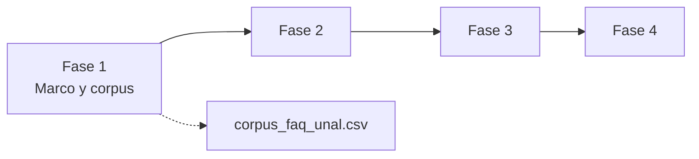
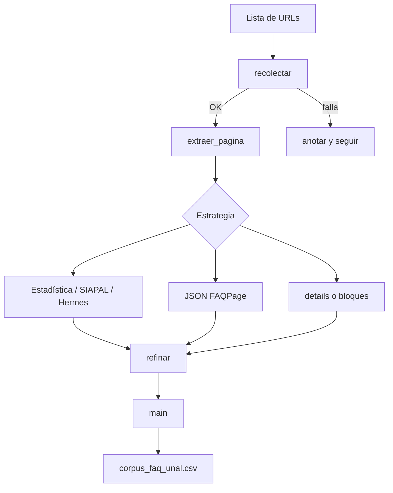

# Fase I — Entendimiento del negocio y carga de textos

**Módulo 4 · Unidad 2 · 10 % del proyecto aplicado**  
**Notebook:** [`m4u2_fase_1_business_data_load.ipynb`](m4u2_fase_1_business_data_load.ipynb)  
**Grupo 12:** David Martínez Triana · Andrés Ramírez Romero · David Delgado Ortiz

[← Volver al README del proyecto](../README.md)

---

## De qué trata esta fase

Definir el problema de negocio y **construir el corpus** que usan las fases siguientes. El sistema objetivo es un asistente que recupera la **respuesta oficial** a una pregunta frecuente de la Universidad Nacional de Colombia.

Esta entrega no limpia NLP a fondo ni entrena un modelo. Deja:

1. el **marco** (trasfondo, alcance, plan de las cuatro entregas);
2. el **origen** de los textos (URLs reales de FAQ);
3. el **código de adquisición** ejecutable;
4. el archivo **`corpus_faq_unal.csv`**.



---

## Estructura del notebook

| Sección | Contenido |
|---------|-----------|
| 1.1 Trasfondo | Quién consulta, qué duele hoy, por qué un recuperador |
| 1.2 Alcance | Qué entra y qué no (no clasificación, no generación) |
| 1.3 Plan | Las cuatro entregas, riesgos, criterio de cierre |
| 2.1 Origen | Lista de fuentes FAQ de la UNAL |
| 2.2 Carga | Scraper unificado + export del CSV |

Cada bloque relevante tiene diagrama Mermaid o explicación bajo el código.

---

## Qué se logró

### Corpus unificado

| Indicador | Resultado |
|-----------|-----------|
| Pares guardados | **839** |
| Fuentes con datos | **22** |
| Columnas del CSV | `pregunta`, `respuesta`, `fuente`, `url`, `titulo_seccion` |
| Filas con sección real | **252** (36 secciones) |
| Páginas sin pares | **12** (404, 503 o HTML sin FAQ) — reportadas, **sin inventar filas** |

### Top fuentes (tras `refinar`)

Ingeniería Bogotá (161), Hermes (136), Bibliotecas — índice (105), Estadística (102), DAMA Manizales (74), y el resto bajo 35 pares por fuente.

### Adquisición



- Stack: `requests` + BeautifulSoup (sin Selenium).
- Preferencia por JSON-LD `FAQPage` cuando hay ≥ 8 pares (caso Ingeniería Bogotá).
- DAMA Manizales: `verify=False` por SSL, con filtro de warning.
- Hermes: `titulo_seccion` vacío a propósito (otros nodos no eran secciones).
- Deduplicación por clave que **incluye la URL**: la misma pregunta en dos páginas se conserva.

---

## Qué se aprendió

1. **El HTML institucional no es uniforme.** Una sola estrategia de parseo no alcanza; hace falta un router por familia de página.
2. **JSON-LD salva corpus grandes** cuando el HTML es un acordeón parcial o un SPA.
3. **Reportar el vacío es parte del entregable.** Las 12 URLs caídas documentan el alcance real.
4. **El esquema debe ser pobre y estable.** Cinco columnas; nada de columnas de diagnóstico en el CSV final.
5. **El marco del negocio condiciona las fases siguientes:** si el objetivo es recuperar un par, no se diseña un clasificador.

---

## Archivos en esta carpeta

| Archivo | Rol |
|---------|-----|
| `m4u2_fase_1_business_data_load.ipynb` | Notebook de la entrega |
| `corpus_faq_unal.csv` | Corpus crudo (839 × 5) |

---

## Cómo ejecutar

```bash
# Desde esta carpeta
jupyter notebook m4u2_fase_1_business_data_load.ipynb
```

Requisitos mínimos: `pandas`, `requests`, `beautifulsoup4`. La ejecución reescribe `corpus_faq_unal.csv` al final.

---

## Criterio de cierre (rúbrica)

- Trasfondo preciso del negocio.
- Objetivo coherente y ordenado.
- Planeación clara de las entregas.
- Código de adquisición **ejecutable, eficiente y entendible**.

Esta fase deja el CSV listo para la [Fase II](../Entrega%20proyecto%20Fase%20II/README.md).
