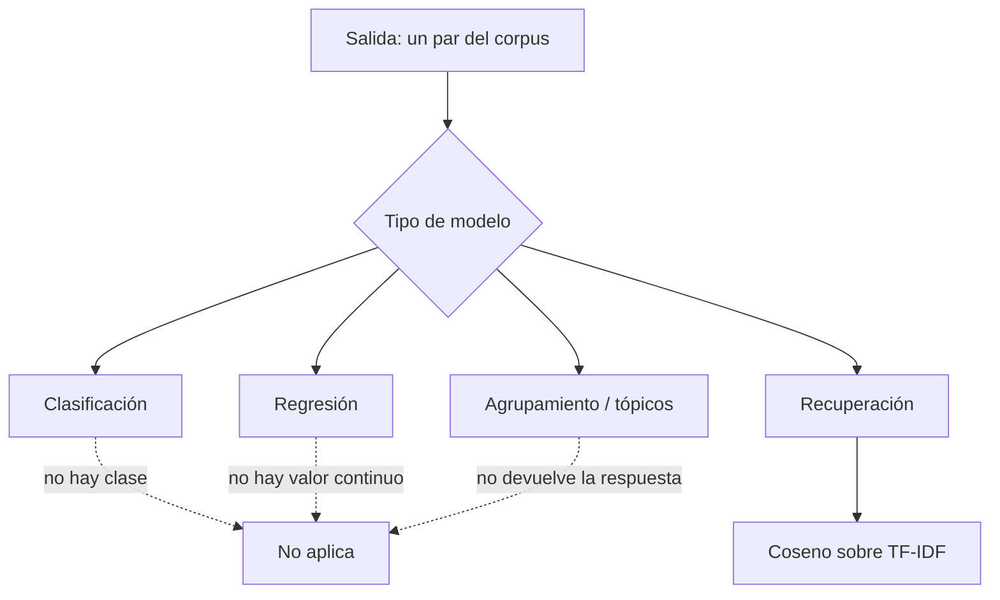
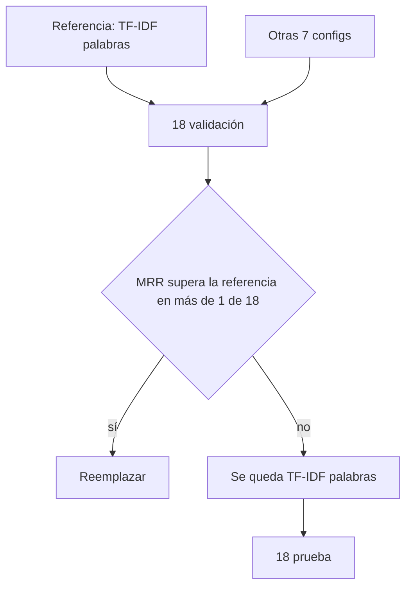
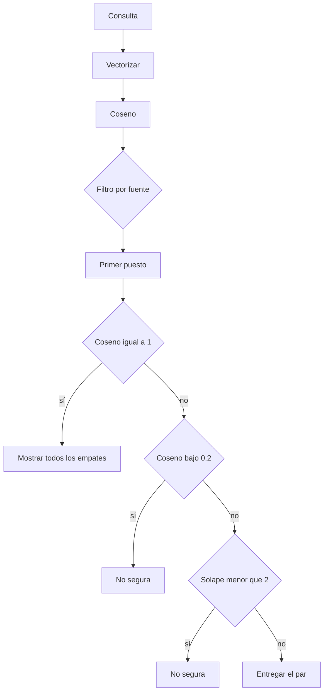

# Fase IV — Modelamiento y evaluación

**Módulo 4 · Unidad 5 · 10 % del proyecto aplicado**  
**Notebook:** [`M4U5_Fase_4_modeling.ipynb`](M4U5_Fase_4_modeling.ipynb)  
**Grupo 12:** David Martínez Triana · Andrés Ramírez Romero · David Delgado Ortiz

[← Volver al README del proyecto](../README.md)

---

## De qué trata esta fase

Entrenar el **recuperador**, comparar configuraciones y medir con consultas que **no** salen de recortar la pregunta oficial. El problema sigue siendo el mismo: una persona pregunta y el sistema devuelve un **par** del corpus.

El Recall@1 **0.912** de la Fase 3 **no es la nota de esta fase**.


---

## Estructura del notebook

| Sección | Contenido |
|---------|-----------|
| 1. Tipo de modelamiento | Por qué recuperación y no clasificación / regresión / tópicos |
| 2.1 Importar modelo | Ocho configuraciones; ninguna usa `fuente` en el vector |
| 2.2 Entrenamiento y selección | 18 consultas de validación + corte fijo |
| 3.1 Evaluación | 18 consultas de prueba + intervalos + fallos |
| 3.2 Aplicación | Función `responder` con reglas de prudencia |

Cinco gráficos principales: selección por MRR, costo vs resultado, ficha de 36 consultas, precisión/cobertura al subir el piso, y las seis consultas que no quedan de primeras.

---

## Por qué este modelo



El modelo es **vecino más cercano** con similitud coseno. Es no supervisado: se ajustan los pesos TF-IDF del índice y se ordenan los pares ante una consulta nueva.

---

## Qué se logró

### Protocolo de evaluación

- **36 paráfrasis** escritas a mano (no son la pregunta oficial sin artículos).
- **18 validación** → eligen el modelo.
- **18 prueba** → miden una sola vez, sin re-elegir.
- Donde dos preguntas oficiales responden lo mismo, **las dos cuentan** como relevantes.
- Empate en el primer coseno cuenta como acierto si **alguna** relevante está empatada.

### Selección (validación)

Regla fija **antes** de mirar la prueba: reemplazar la referencia solo si el MRR supera **referencia + 1/18** (corte **0.928**).

| Configuración | Recall@1 | Recall@5 | MRR | Pesos |
|---------------|---------:|---------:|----:|------:|
| TF-IDF, caracteres 3–5 | 0.833 | 1.000 | 0.889 | 123 240 |
| **TF-IDF, palabras** | **0.833** | **0.944** | **0.872** | **8 816** |
| TF-IDF, max_df 0.5 | 0.833 | 0.944 | 0.872 | 8 288 |
| TF-IDF, sublinear | 0.833 | 0.944 | 0.871 | 8 816 |
| TF-IDF, min_df 2 | 0.667 | 0.944 | 0.780 | 8 093 |
| TF-IDF, bigramas | 0.611 | 0.833 | 0.704 | 17 389 |
| Conteos, palabras | 0.500 | 0.611 | 0.573 | 8 816 |
| TF-IDF, sobre la respuesta | 0.278 | 0.500 | 0.387 | 38 572 |

Nadie cruzó el corte. Se queda **TF-IDF de palabras** (referencia de la Fase 3).



### Prueba (no usada en la elección)

| Modelo | Recall@1 | Recall@5 | MRR |
|--------|---------:|---------:|----:|
| **TF-IDF, palabras** | **0.833** | **0.944** | **0.880** |
| Conteos, palabras | 0.444 | 0.667 | 0.540 |

- Wilson 95 % del Recall@1: **0.608 – 0.942**
- Remuestreo 95 % del MRR: **0.732 – 1.000**
- 15/18 de primeras; 17/18 en el top-5
- Ninguna de las 36 paráfrasis cayó bajo coseno 0.2

### Fallos que el notebook muestra

| Conjunto | Consulta (idea) | Qué pasó |
|----------|-----------------|----------|
| Prueba | «dos idiomas» en Explora | Puesto 308: el corpus dice *idioma* |
| Prueba | nota del proyecto en Hermes | Puesto 3: gana «nota definitiva» del SIA |
| Prueba | aval para convocatoria externa | Puesto 2: gana aval de grupo de investigación |
| Validación | comodines del SIA | Gana «¿Sabes que es el SIA?» por la sigla |
| Validación | papeles de movilidad | Gana el cierre de convocatoria |
| Validación | normas generales | Ganan las normas NTC |

### Aplicación: `responder`



Demostraciones en el notebook:

1. Paráfrasis de Medicina → un par seguro.
2. Cancelación del periodo → **tres** filas a coseno 1; **tres respuestas distintas** (SIA/formulario vs Consejo de Facultad vs Estadística).
3. Mismo caso filtrado a `fuente="Estadística"`.
4. Clave del SIA → empate SIAPAL | DAMA.
5. Texto sin términos del corpus → coseno 0, no se entrega.
6. Menú de cafetería → coseno &gt; 0.2 pero solape 0 → no segura.
7. «Entidad externa» → glosario, sin meter `fuente` al vector.

---

## Qué se aprendió

1. **La métrica de producto exige consultas nuevas.** El 0.912 no basta.
2. **Fijar el corte antes del test** evita sobreajustar a 18 preguntas.
3. **Casi empatar con 14× el índice no es una mejora** (caracteres).
4. **Buscar en la respuesta sigue siendo malo** (MRR 0.387).
5. **Un empate puede esconder conflicto entre oficinas** — hay que mostrarlo.
6. **El umbral 0.2 no se calibra solo con paráfrasis in-domain**; el solape de contenido complementa.
7. **Con n=18 el intervalo es ancho**; reportarlo es parte del rigor.
8. **Los fallos de morfología y sinónimos** (*idiomas* / *idioma*, *papeles* / *documentos*) apuntan a embeddings densos o lemas como siguiente experimento — fuera del alcance cerrado de esta entrega, pero diagnosticados.

---

## Archivos en esta carpeta

| Archivo | Rol |
|---------|-----|
| `M4U5_Fase_4_modeling.ipynb` | Notebook de la entrega |
| `corpus_faq_unal_fase2_limpio.csv` | Índice (salida de Fase II) |

---

## Cómo ejecutar

```bash
# cwd = esta carpeta
jupyter notebook M4U5_Fase_4_modeling.ipynb
```

Dependencias: `pandas`, `numpy`, `matplotlib`, `scikit-learn`.

---

## Criterio de cierre (rúbrica)

- Modelo **adecuado** al corpus y al problema (recuperación, no clasificación).
- Entrenamiento / ajuste **correcto** sobre las 839 preguntas.
- Comparación de configuraciones que **informa** la decisión (y aquí confirma la referencia sin pagar el costo de caracteres).

Reglas heredadas y respetadas:

1. El 0.912 no es la nota de esta fase.  
2. Coseno 1 = empate (mostrar todos).  
3. Coseno &lt; 0.2 ≠ respuesta segura.  
4. `fuente` filtra; no entra al vector.

---

## Cierre del proyecto aplicado (Módulo 4)

Con esta fase el hilo queda cerrado:

| Fase | Entregó |
|------|---------|
| I | Corpus real de FAQ UNAL |
| II | Exploración + texto limpio |
| III | Representación TF-IDF words |
| IV | Recuperador medido con paráfrasis |

Volver al [README principal](../README.md) para la vista de portafolio.
