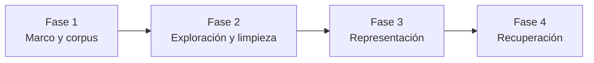

# Recuperación de FAQ — Universidad Nacional de Colombia

**Diplomado en Machine Learning y Data Science Avanzado · Módulo 4 (NLP)**  
**Universidad Nacional de Colombia**  
**Grupo 12:** David Martínez Triana · Andrés Ramírez Romero · David Delgado Ortiz  
**Profesor:** Felipe Restrepo Calle · **Asistente:** Juan Sebastián Lara Ramírez

---

## Presentación del portafolio

Este repositorio documenta el **proyecto aplicado del Módulo 4**. El hilo conductor es un sistema de **recuperación de preguntas frecuentes (FAQ)** para la Universidad Nacional de Colombia: una persona escribe una consulta en lenguaje natural y el sistema devuelve el **par pregunta–respuesta oficial** publicado en las páginas de la Universidad.

No es un clasificador de intenciones ni un generador de texto libre. Es un **recuperador**: el índice son 839 pares reales, la representación es TF-IDF sobre la pregunta normalizada, y la decisión se toma con similitud coseno, con reglas explícitas para empates, coincidencias débiles y filtro por fuente.

El trabajo está organizado en **cuatro entregas** (10 % del proyecto cada una), alineadas con las unidades del módulo. Cada carpeta contiene el notebook ejecutado, los datos necesarios para reproducir esa fase y un README propio.



| Fase | Carpeta | Notebook | Entregable principal |
|------|---------|----------|----------------------|
| I | [`Entrega proyecto fase I`](Entrega%20proyecto%20fase%20I/) | `m4u2_fase_1_business_data_load.ipynb` | `corpus_faq_unal.csv` (839 pares) |
| II | [`Entrega proyecto Fase II`](Entrega%20proyecto%20Fase%20II/) | `M4U3_Fase_2_exploratory_data_analysis.ipynb` | `corpus_faq_unal_fase2_limpio.csv` |
| III | [`Entrega proyecto Fase III`](Entrega%20proyecto%20Fase%20III/) | `M4U4_Fase_3_feature_extraction.ipynb` | Matriz TF-IDF 839 × 1457 |
| IV | [`Entrega proyecto fase IV`](Entrega%20proyecto%20fase%20IV/) | `M4U5_Fase_4_modeling.ipynb` | Recuperador evaluado (MRR 0.880 en prueba) |

---

## De qué trató el proyecto

### Problema de negocio

La Universidad publica FAQs en muchas sedes y dependencias (Ingeniería, Hermes, Bibliotecas, Estadística, SIAPAL, DAMA, Bienestar, ORI, etc.). Un estudiante o funcionario suele:

- no saber en qué página buscar;
- formular la misma duda con otras palabras;
- encontrar la misma pregunta en dos oficinas, a veces con respuestas distintas.

El objetivo del sistema es **recuperar el par oficial** que mejor responde a una consulta nueva, mostrar de qué fuente sale y no vender como segura una coincidencia débil.

### Objetivo técnico

Construir, fase a fase:

1. un **corpus unificado** de preguntas y respuestas oficiales;
2. un **análisis y un preprocesamiento** útiles para recuperación (no para clasificación);
3. una **representación vectorial** acorde al tamaño del corpus (839 documentos);
4. un **modelo de recuperación** comparado con hiperparámetros y medido con consultas que no son un recorte de la pregunta oficial.

### Lo que el proyecto no es

- No es clasificación de intenciones ni NER.
- No es un chatbot generativo.
- No inventa filas para URLs caídas (404, 503, SPA vacías).
- No mete `fuente` dentro del vector: la fuente **filtra y se muestra**, no entra como feature.

---

## Qué se logró

### Corpus (Fase 1 → 2)

| Indicador | Valor |
|-----------|------:|
| Pares pregunta–respuesta | **839** |
| Fuentes con al menos un par | **22** |
| Filas con título de sección real | **252** (36 secciones distintas) |
| Preguntas distintas | **785** |
| Preguntas publicadas en dos o más fuentes | **24** (51 filas) |
| Esquema del CSV crudo | `pregunta`, `respuesta`, `fuente`, `url`, `titulo_seccion` |

Top 5 fuentes: Ingeniería Bogotá (161), Hermes (136), Bibliotecas — índice (105), Estadística (102), DAMA Manizales (74). Esas cinco concentran el **68.9 %** del corpus. Doce URLs de la lista original no aportaron pares (404, 503 o HTML sin FAQ) y se reportaron sin inventar datos.

### Limpieza (Fase 2)

- Texto original **sin pisar**.
- `pregunta_normalizada` / `respuesta_normalizada`: minúsculas, espacios, tipografía unificada.
- `pregunta_texto_limpio` / `respuesta_texto_limpio`: lemas con spaCy (`es_core_news_sm`), en lote con `nlp.pipe`.
- Se quitan DET, ADP, CCONJ, SCONJ, PRON, PART. **Se conservan verbos y auxiliares** (si se borraban todos los stopwords de spaCy, preguntas como «¿qué puedo hacer?» quedaban vacías).
- Tras la limpieza: **0** preguntas vacías de lemas; media **6.5** lemas útiles.

### Representación (Fase 3)

Comparación justa (misma consulta corta, `min_df=1`) entre cinco representaciones:

| Representación | Términos | Pesos | Recall@1 | Recall@5 | MRR |
|----------------|--------:|------:|---------:|---------:|----:|
| **TF-IDF, palabras** | 1 457 | 8 816 | **0.912** | 0.998 | **0.953** |
| TF-IDF, caracteres 3–5 | 11 559 | 123 240 | 0.909 | 0.998 | 0.952 |
| Conteos, palabras | 1 457 | 8 816 | 0.905 | 0.998 | 0.948 |
| TF-IDF, bigramas | 5 567 | 17 389 | 0.902 | 0.998 | 0.947 |
| TF-IDF, lemas | 1 033 | 5 312 | 0.901 | 0.996 | 0.947 |

**Decisión:** TF-IDF de palabras sueltas sobre `pregunta_normalizada` (matriz **839 × 1457**, densidad **0.72 %**). Los caracteres casi empatan y cuestan ~14× en pesos guardados.

> El **0.912** compara representaciones con una **copia acortada** de la pregunta oficial. **No es la nota de la Fase 4.**

Hallazgos que la Fase 4 hereda:

- El **43.6 %** de los vecinos más cercanos **cruzan de fuente**.
- **107** preguntas tienen otra con coseno ≈ 1 (99 cadenas idénticas; 8 solo cambian coma, espacio o ¿).
- **11** preguntas tienen vecino bajo **0.2**.

### Modelamiento (Fase 4)

- Modelo: **vecino más cercano** con similitud coseno (no supervisado).
- 36 consultas **paráfrasis** escritas a mano: 18 validación + 18 prueba.
- Regla de selección fija **antes** de mirar la prueba: otra configuración solo reemplaza a TF-IDF palabras si gana por más de **1/18** en MRR de validación (corte **0.928**). Nadie lo cruzó.

| Conjunto | Modelo | Recall@1 | Recall@5 | MRR |
|----------|--------|---------:|---------:|----:|
| Validación | TF-IDF palabras | 0.833 | 0.944 | 0.872 |
| **Prueba** | **TF-IDF palabras** | **0.833** | **0.944** | **0.880** |
| Prueba | Conteos (baseline) | 0.444 | 0.667 | 0.540 |

Intervalo de Wilson al 95 % del Recall@1 en prueba: **0.608 – 0.942**. Remuestreo del MRR: **0.732 – 1.000**. Con 18 consultas el punto central es sólido frente a los conteos; el intervalo recuerda que la muestra es pequeña.

Aplicación (`responder`):

- coseno **1** → se muestran **todos** los empates (aunque las respuestas discrepen entre páginas);
- coseno **&lt; 0.2** → no se presenta como respuesta segura;
- solape de contenido **&lt; 2** → tampoco;
- `fuente` solo **filtra** después del coseno.

---

## Qué se aprendió

### Sobre el problema de NLP

1. **La tarea define el modelo.** Con FAQs el acierto no es una clase: es un índice del corpus. Forzar clasificación hubiera inventado etiquetas que el negocio no tiene.
2. **El campo importa más que el truco de representación.** Buscar sobre la respuesta bajó el MRR a ~0.24 (Fase 2) / 0.387 (Fase 4). La pregunta corta es el texto correcto para indexar.
3. **Una métrica de diagnóstico no es la métrica de producto.** Recortar la pregunta oficial y buscarla contra sí misma (0.912) sirve para comparar embeddings; no mide a un usuario real.
4. **El empate es información.** Un coseno 1 entre tres filas de «cancelación del periodo académico» reveló **tres textos de respuesta distintos**. Devolver una sola fila habría ocultado el conflicto entre oficinas.
5. **La tipografía y los stopwords no son detalles cosméticos.** Comillas curvas, rayas y viñetas contaminaban el análisis de «ruido». Borrar todos los stopwords de spaCy vació preguntas reales en español.

### Sobre ciencia de datos aplicada

1. **No inventar datos.** Doce URLs muertas se documentaron; el corpus se construyó solo con lo que se pudo leer.
2. **Documentar código → explicación.** Cada bloque ejecutable tiene debajo la lectura de lo que imprimió, alineada con la plantilla oficial.
3. **Fijar la regla de selección antes del test.** El corte «referencia + 1/18» evitó adoptar caracteres por un empate técnico caro.
4. **Reportar intervalos, no solo el punto.** El 0.833 con IC [0.61, 0.94] comunica honestidad metodológica.
5. **Separar feature de metadato.** `fuente` fuera del vector permite filtrar el glosario sin sesgar el espacio semántico.

### Sobre el stack

- Adquisición con `requests` + BeautifulSoup (JSON-LD `FAQPage`, acordeones, `details/summary`, walker por bloques).
- spaCy `es_core_news_sm` con `nlp.pipe` (batch 64).
- scikit-learn: `TfidfVectorizer`, `CountVectorizer`, `cosine_similarity`.
- Visualización y tablas en cada fase; diagramas Mermaid para el flujo.

---

## Estructura del repositorio

```text
NLP/
├── README.md                          ← este documento
├── Entrega proyecto fase I/
│   ├── README.md
│   ├── m4u2_fase_1_business_data_load.ipynb
│   └── corpus_faq_unal.csv
├── Entrega proyecto Fase II/
│   ├── README.md
│   ├── M4U3_Fase_2_exploratory_data_analysis.ipynb
│   ├── corpus_faq_unal.csv
│   ├── corpus_faq_unal_fase2_limpio.csv
│   └── corpus_faq_unal_fase2_limpieza.xlsx
├── Entrega proyecto Fase III/
│   ├── README.md
│   ├── M4U4_Fase_3_feature_extraction.ipynb
│   └── corpus_faq_unal_fase2_limpio.csv
└── Entrega proyecto fase IV/
    ├── README.md
    ├── M4U5_Fase_4_modeling.ipynb
    └── corpus_faq_unal_fase2_limpio.csv
```

---

## Cómo reproducir

### Requisitos

- Python 3.10+ (desarrollado en 3.13)
- `pandas`, `numpy`, `matplotlib`, `seaborn`, `scikit-learn`, `beautifulsoup4`, `requests`, `spacy`, `openpyxl`
- Modelo spaCy: `es_core_news_sm`

```bash
pip install pandas numpy matplotlib seaborn scikit-learn beautifulsoup4 requests spacy openpyxl
python -m spacy download es_core_news_sm
```

### Orden recomendado

1. Abrir la **Fase I** y ejecutar (o usar el CSV ya generado).
2. **Fase II** lee `corpus_faq_unal.csv` y exporta el limpio.
3. **Fase III** y **Fase IV** leen `corpus_faq_unal_fase2_limpio.csv` (incluido en esas carpetas).

Cada notebook está pensado para correrse con el working directory = carpeta de la fase.

---

## Reglas de diseño que atraviesan las cuatro fases

1. El 0.912 de la Fase 3 **no** es la nota de la Fase 4.
2. Un coseno de **1** es un **empate**: se muestran todos los pares.
3. Un vecino bajo **0.2** no se presenta como respuesta segura.
4. **`fuente` filtra y se muestra**; no entra al vector.
5. El texto original **no se pisa** en la limpieza.
6. No se inventan filas para URLs sin FAQ.

---

## Lectura sugerida del portafolio

1. Empezar por este README (mapa y resultados).
2. Leer el [README de la Fase I](Entrega%20proyecto%20fase%20I/README.md) y hojear el notebook (marco + adquisición).
3. Fase II: exploración, desbalance, duplicados y limpieza.
4. Fase III: por qué TF-IDF de palabras y no caracteres ni lemas.
5. Fase IV: validación vs prueba, fallos impresos y función `responder`.

---

## Créditos académicos

- **Profesor:** [Felipe Restrepo Calle](https://dis.unal.edu.co/~ferestrepoca/)
- **Asistente docente:** [Juan Sebastián Lara Ramírez](https://www.linkedin.com/in/juan-sebastian-lara-ramirez-43570a214/)
- **Universidad Nacional de Colombia** — Facultad de Ingeniería

---

*Proyecto aplicado · Módulo 4 · NLP · Diplomado ML & Data Science Avanzado · 2026*
